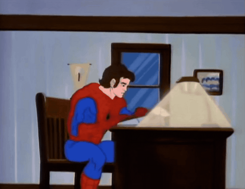

  

Hi, I'm Yuvraj.

I like building close to the metal — backends, developer tools, and ML. Currently into Rust, and Rust is in me.

A few things I've been building:

- **[notopod](https://github.com/Yuvraj-cyborg/notopod)** – Terminal Markdown editor: formats as you type, and paints diagrams, math, and Manim scenes right in the terminal.
- **[P2rent](https://github.com/Yuvraj-cyborg/P2rent)** – Swarm-copy large files over QUIC. Every machine that downloads also serves; BLAKE3-verified, one binary.
- **[Bayronik](https://github.com/Yuvraj-cyborg/Bayronik)** – Field-level baryonic emulator for weak lensing: a Rust N-body plus a U-FNO that maps dark-matter fields to total matter in milliseconds.

Curious by default. Shipping often.
