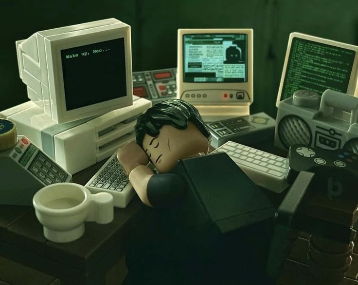

  

Hi, I'm Yuvraj.

I like programming in general. Currently into broader aspects of formal verifications and zk.

My latest craft u should try :

- **[procmon](https://proc.yuvich.com)** - The last system monitor you would ever need.

